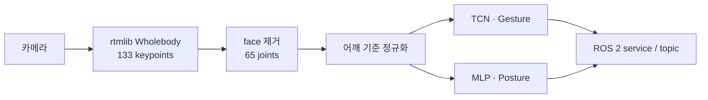
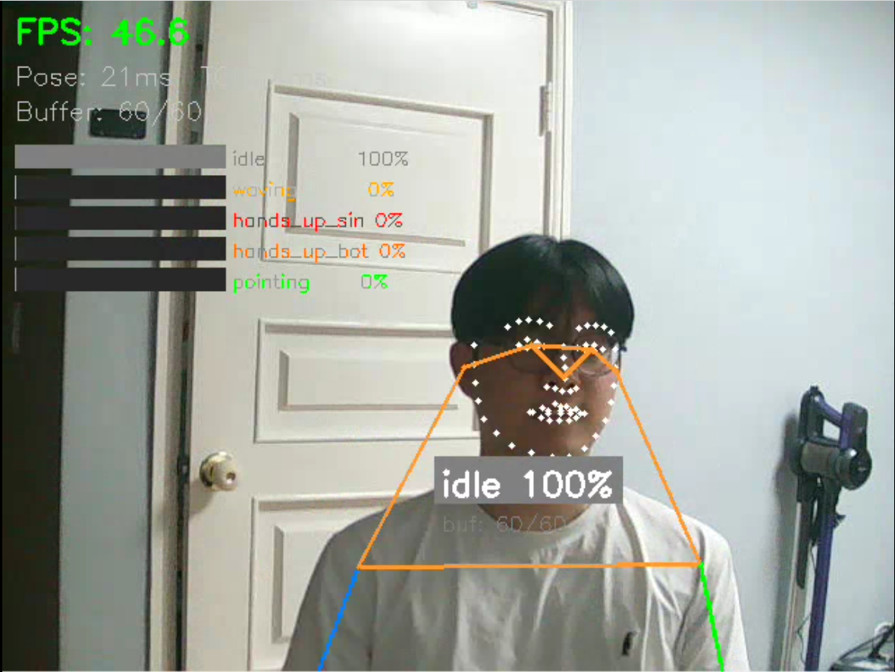
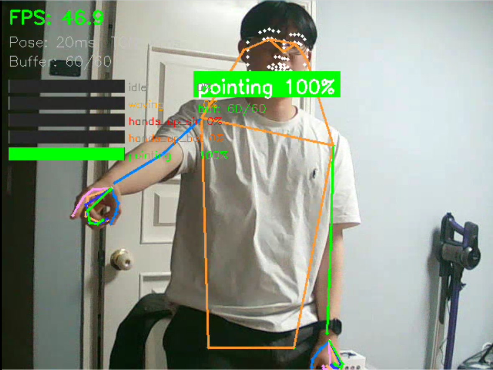
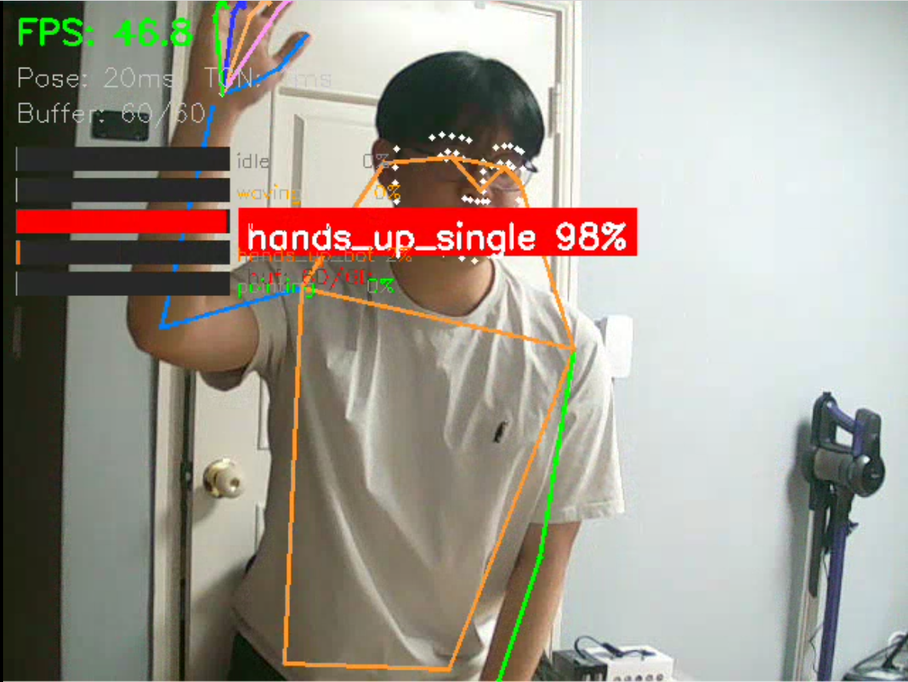
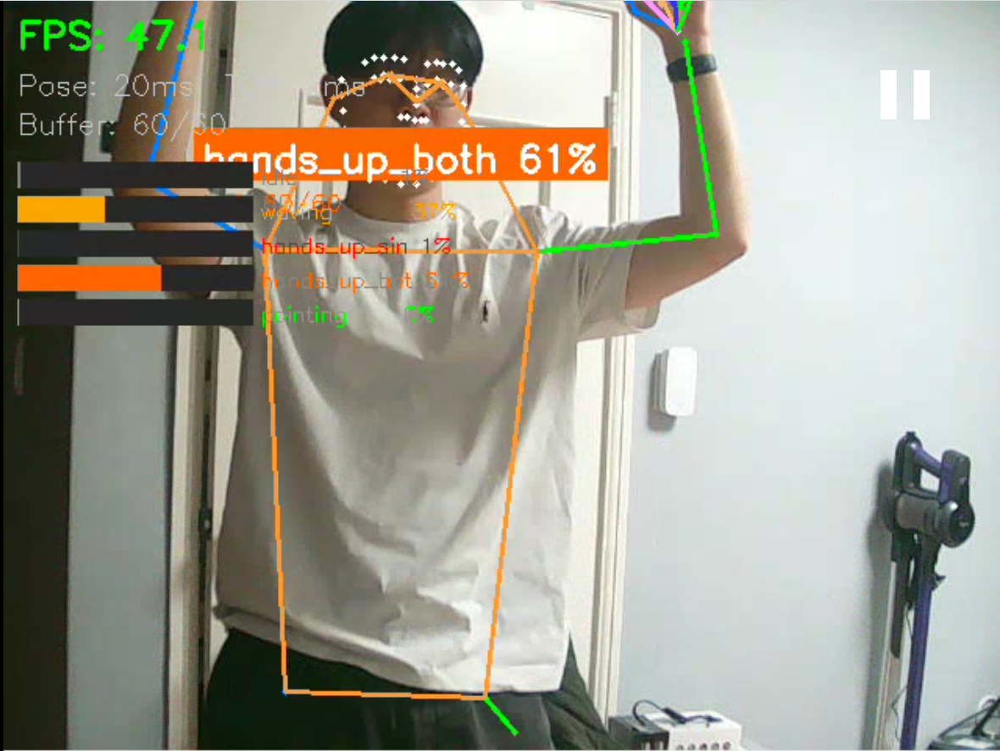
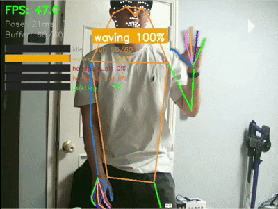

# Skeleton-based Posture & Gesture Recognition

**사람의 자세(서기·앉기·눕기)와 제스처(손 흔들기·손 들기·가리키기·정지)를 스켈레톤으로 인식하고, ROS 2로 로봇에 연결하는 프로젝트입니다.**


RoboCup@Home 2026 (team Inha-United)에서 사람과의 상호작용(HRI) 모듈로 사용했습니다.

| 모델 | 입력 | 출력 | 성능 |
|---|---|---|---|
| **Gesture TCN** | 65-joint wholebody 시퀀스 | 6 클래스 | Val Acc **96.9 %** (349 / 360) |
| **Posture MLP** | 17-joint 단일 프레임 + bone distance | 3 클래스 | F1 0.78–0.93 |



<table>
  <tr>
    <td width="50%" align="center"><br/><b>Idle</b></td>
    <td width="50%" align="center"><br/><b>Pointing</b></td>
  </tr>
  <tr>
    <td width="50%" align="center"><br/><b>Hand Up (Single)</b></td>
    <td width="50%" align="center"><br/><b>Hand Up (Both)</b></td>
  </tr>
</table>

<p align="center">
  <br/>
  <b>Waving</b>
</p>

---

## 클래스 구성

### Posture Recognition (MLP) — 단일 프레임

| Label | 이름 | 데이터 |
|-------|------|--------|
| 0 | sitting | POLAR dataset |
| 1 | standing | POLAR dataset |
| 2 | lying | POLAR dataset |

### Gesture Recognition (TCN) — 시퀀스 (65-joint wholebody)

| Label | 이름 | 데이터 |
|-------|------|--------|
| 0 | idle | 커스텀 수집 |
| 1 | waving | 커스텀 수집 |
| 2 | hands_up_single | 커스텀 수집 |
| 3 | hands_up_both | 커스텀 수집 |
| 4 | pointing | 커스텀 수집 |
| 5 | stop | 커스텀 수집 |

---

## 프로젝트 구조

```text
├── models/                     # 모델 정의
│   ├── mlp.py                  #   MLP (Posture)
│   └── tcn.py                  #   TCN (Gesture, dilated causal conv)
├── data/                       # 데이터셋 클래스와 split
│   ├── dataset.py              #   MLP 데이터셋 (단일 프레임)
│   ├── ntu_dataset.py          #   TCN 데이터셋 (시퀀스)
│   ├── collect_skeleton.py     #   이미지 → 스켈레톤 추출
│   ├── ImageSets/              #   train/val split 파일
│   └── dataset/ images/ ...    #   원본·추출 데이터 (gitignore)
├── src/                        # 학습 · 평가 · 추론 진입점
│   ├── train.py / val.py       #   MLP
│   ├── train_tcn.py / val_tcn.py   # TCN
│   ├── finetune_pointing.py    #   pointing 클래스 파인튜닝
│   ├── inference.py            #   MLP 추론 (.npy / 웹캠)
│   ├── inference_tcn.py        #   TCN 실시간 추론
│   └── collect_data.py         #   웹캠 데이터 수집
├── runtime/                    # 추론 공통 모듈 (src/ 와 ROS 노드가 함께 사용)
│   ├── frame_inferencer.py     #   MLP/TCN 프레임 단위 추론기
│   ├── mlp_runtime.py · tcn_runtime.py
│   ├── realtime_inference_common.py
│   └── realtime_viz.py         #   HUD · 확률 막대 · 트랙 라벨
├── utils/                      # 스켈레톤 연산 · 정규화 · bone distance · 트래킹
├── tools/                      # 데이터 준비 스크립트 (프로젝트 루트에서 실행)
│   ├── extract_wholebody_skeleton.py   # 비디오 → 65-joint pkl
│   ├── extract_yolo_pose_skeleton.py   # YOLO-Pose 기반 추출 (비교용)
│   ├── augment_wholebody_skeleton.py   # 스케일 증강
│   ├── convert_8to6class.py            # 8 → 6 클래스 변환
│   ├── extract_ntu_subset.py           # NTU-120 subset 추출
│   └── merge_pkl.py                    # NTU + 커스텀 병합
├── ros2_ws/src/                # ROS 2 패키지
│   ├── Posture_and_Gesture/    #   gesture_detect_node · posture_detect_node
│   └── detection_stability/    #   LiDAR·TF 기반 안정 인물 선택 (C++)
├── rtmlib/                     # vendored rtmlib (pose tracker)
├── assets/                     # README 이미지
└── requirements.txt
```

---

## 환경 설정

```bash
pip install -r requirements.txt
```

[rtmlib](https://github.com/Tau-J/rtmlib)가 별도 경로에 설치되어 있어야 합니다.

---

## 스켈레톤 구조 (65-joint, face 제거)

RTMPose Wholebody 133 keypoints에서 **face 68개를 제거**한 65-joint:

| 구간 | 인덱스 | 갯수 |
|------|--------|------|
| Body (COCO) | 0-16 | 17 |
| Feet | 17-22 | 6 |
| Left Hand | 23-43 | 21 |
| Right Hand | 44-64 | 21 |
| **합계** | | **65** |

TCN 입력: `(batch, 130, T)` — 65 joints × 2 coords, T = 시퀀스 길이

---

## 사용법

전체 파이프라인은 **수집 → 추출 → 학습 → 평가 → 추론** 5단계.

```
[비디오 클립 .avi]  →  [스켈레톤 .pkl]  →  [학습 .pth]  →  [실시간 추론]
  data/dataset/         wholebody_6class.pkl   models/best_tcn_xsub.pth
```

### 0. 환경

```bash
conda create -n pgr python=3.10 -y
conda activate pgr
pip install --index-url https://download.pytorch.org/whl/cu128 torch torchvision
pip install opencv-python tqdm onnxruntime-gpu numpy
```

저장소 루트의 [rtmlib/](rtmlib/)를 그대로 사용 (sys.path로 자동 import).

### 1. 데이터 준비

#### 1-a. 디렉토리 배치

각 클래스 폴더를 **`data/dataset/<class_name>/`** 아래에 두고 그 안에 `.avi`/`.mp4` 비디오 클립을 모음. 폴더명이 곧 라벨이라 오타 주의 (대소문자 구분).

```
data/dataset/
├── idle/            ← label 0
│   ├── clip_000001.avi
│   └── ...
├── wave/            ← label 1
├── hand_up/         ← label 2 (한 손)
├── hand_up_both/    ← label 3 (양 손)
├── pointing/        ← label 4
└── stop/            ← label 5
```

폴더명 ↔ 라벨 매핑은 [tools/extract_wholebody_skeleton.py](tools/extract_wholebody_skeleton.py) (`FOLDER_TO_LABEL`)에서 정의. 새 클래스를 추가하려면 여기에 항목을 더하고 [data/ntu_dataset.py#L36-L44](data/ntu_dataset.py#L36-L44)의 `NTU_ACTION_NAMES`에도 같은 라벨을 추가.

#### 1-b. 클립 녹화 방법

> TODO: 별도 영상 녹화 스크립트 추가 예정 (위치만 명시) — [src/collect_data.py](src/collect_data.py)는 웹캠에서 스켈레톤(.pkl)을 바로 수집하는 도구이며, **이 프로젝트는 .avi 영상을 한 번 거쳐서 추출하는 워크플로우**임.

권장 녹화 가이드:
- 한 클립당 약 **3~4초** (≈ 90~120 frame @ 30 fps).
- 해상도 **640×480** 권장 (스크립트 기본값과 매치).
- 한 사람만 등장하는 게 이상적. 다인원 클립이 섞이면 추출 단계에서 `--person_select largest`로 보정 (아래).
- 클래스당 **최소 100~300개** 정도 모으면 안정적. (현재 데이터셋: 클래스당 300개)

#### 1-c. 스켈레톤 추출

```bash
python tools/extract_wholebody_skeleton.py --out wholebody_6class.pkl --person_select largest
```

- 각 비디오를 프레임 단위로 디코딩 → rtmlib `PoseTracker(Wholebody)`로 133-keypoint 추출 → face 68개 제거 → **(1, T, 65, 2)** + score 텐서로 묶음.
- 라벨별 **stratified 8:2 train/val split**을 자동 생성 (`xsub_train/xsub_val/xset_train/xset_val` 키 4개 모두 동일 split).
- 결과물: 프로젝트 루트에 `wholebody_6class.pkl` 1개 파일.

| 옵션 | 기본값 | 설명 |
|------|--------|------|
| `--data_dir` | `data/dataset` | 클래스 폴더가 있는 루트 |
| `--out` | `wholebody_6class.pkl` | 출력 pkl 경로 |
| `--person_select` | `largest` | `first` = tracker[0] (단일 인물 시), `largest` = 가장 큰 bbox (다인원 권장), `center` = 화면 중앙에 가까운 사람 |
| `--score_thr` | 0.3 | `largest`/`center` 측정 시 keypoint 신뢰도 임계값 |
| `--train_ratio` | 0.8 | train/val split 비율 |
| `--device` | `cuda` | rtmlib backend device |
| `--backend` | `onnxruntime` | `onnxruntime` / `opencv` |

RTX 4060 Ti 기준 약 2초/클립, 1800클립이면 약 1시간.

#### 1-d. (선택) NTU-120 subset과 병합

NTU-120 RGB+D의 일부 행동을 추가로 섞고 싶을 때:

```bash
python tools/extract_ntu_subset.py --src /path/to/ntu120_2d.pkl --out ntu_5class.pkl
python tools/merge_pkl.py --ntu ntu_5class.pkl --custom wholebody_6class.pkl --out merged.pkl
```

> 주의: NTU subset은 17-joint(body only)라서 65-joint 커스텀 데이터와 channel 수가 안 맞음. 둘 다 쓰려면 두 데이터 모두 같은 joint 차원으로 맞추는 전처리가 필요.

### 2. 학습

#### TCN (Gesture, 6-class)

```bash
python src/train_tcn.py --pkl wholebody_6class.pkl --split xsub --epochs 100
```

- 입력: `(B, 130, T)` — 65 joints × 2 (어깨 중심·어깨 길이로 프레임별 정규화 후 V*C로 flatten)
- 손실: `CrossEntropyLoss` + 역빈도 class weights
- 옵티마: AdamW(lr 1e-3, wd 1e-4) + CosineAnnealingLR, gradient clip 1.0
- Augment: horizontal flip + left/right joint swap, temporal shift, gaussian noise, scale
- Early stopping: val acc 기준 patience=15
- 저장 위치: `models/best_tcn_{split}.pth` (체크포인트에 input_dim/num_classes/hidden_dims 등 메타 포함 → 추론 때 자동 복원)

| 옵션 | 기본값 | 설명 |
|------|--------|------|
| `--pkl` | `wholebody_6class.pkl` | 학습 데이터 pkl |
| `--split` | `xsub` | 분할 (xsub / xset) |
| `--epochs` | 100 | 학습 에폭 |
| `--batch_size` | 32 | 배치 크기 |
| `--lr` | 1e-3 | 학습률 |
| `--patience` | 15 | Early stopping |
| `--max_frames` | 120 | 최대 시퀀스 길이 (이보다 길면 uniform sampling, 짧으면 zero-pad + mask) |
| `--hidden_dims` | 64 128 128 256 | TCN 채널 |
| `--kernel_size` | 5 | causal conv kernel |
| `--dropout` | 0.3 |  |

#### MLP (Posture, 3-class)

```bash
python src/train.py
```

POLAR dataset (`data/Annotations/`, `data/ImageSets/`, `data/skeletons/`)이 준비되어 있어야 함.

### 3. 평가

```bash
python src/val_tcn.py --pkl wholebody_6class.pkl --split xsub_val
python src/val.py
```

각각 confusion matrix와 클래스별 P/R/F1을 출력.

### 4. 실시간 추론

#### Gesture (TCN) — 웹캠

```bash
python src/inference_tcn.py
python src/inference_tcn.py --source video.mp4
python src/inference_tcn.py --source image.jpg
```

| 키 | 동작 |
|----|------|
| q | 종료 |
| r | 버퍼 초기화 |

#### Posture (MLP) — 웹캠

```bash
python src/inference.py --webcam
python src/inference.py --webcam --source video.mp4
python src/inference.py skeleton.npy    # .npy 파일 추론
```

## ROS 2 연동

```bash
cd ros2_ws
colcon build --symlink-install
source install/setup.bash
ros2 run Posture_and_Gesture gesture_detect_node
```

| 노드 | 역할 | 주요 인터페이스 |
|---|---|---|
| `gesture_detect_node` | 카메라 이미지에서 사람별 트랙을 유지하며 TCN으로 제스처 분류 | 입력 `/camera/camera_head/color/image_raw/compressed`, 출력 `/gesture_and_posture/detection`, 서비스 `GestureDetection` |
| `posture_detect_node` | MLP로 자세 분류 | 같은 카메라 입력 |
| `detection_stability` | 2D 검출을 LiDAR·TF와 결합해 안정적인 사람 한 명을 `map` 좌표로 선택 | 액션 `select_stable_person`, 출력 `/gesture_and_posture/selected_person/point` |

`inha_interfaces`(팀 메시지 패키지)가 같은 워크스페이스에 있어야 빌드됩니다. 노드는 `runtime/`, `models/`를 그대로 import하므로 학습 코드와 추론 코드가 한 벌로 유지됩니다.

## 제공해주는 데이터셋 및 모델

### DataSet
|data structure| 링크|
|---|---|
|Only Skeleton|[Skeleton Download Link](https://drive.google.com/file/d/1b7dn6unjZZlvGphD1HsmhofyoLXEiqyp/view?usp=sharing)|
|All Video|[Video Download link](https://drive.google.com/file/d/1b7dn6unjZZlvGphD1HsmhofyoLXEiqyp/view?usp=sharing)|

### Pretrained model

| model | 링크 |
|----|----|
|MLP|[MLP Download Link](https://drive.google.com/file/d/1Prnip7Zo3Brh01LBdNcXS_PHi1OCp3Gt/view?usp=drive_link)|
|TCN|[TCN Download Link](https://drive.google.com/file/d/1mNUcOMt5AlNlY6JNDcyVvuuUfQ97LW7E/view?usp=drive_link)|

---

## 모델 아키텍처

### TCN (Temporal Convolutional Network)
- Dilated causal convolution (dilation: 1→2→4→8)
- Residual connections + BatchNorm + Dropout
- Masked global average pooling → FC classifier
- 입력: `(B, 130, T)` — 65 joints × 2

### MLP
- 3-layer FC (256→128→3)
- 입력: 50-dim (17 joints × 2 + 16 bone distances)

### 정규화
- 어깨 중점 이동 → 어깨 거리 스케일링 → low confidence zeroing

## 학습 결과

### Posture MLP
||precision|recall|F1 score|
|---|---|---|---|
|standing|0.9532|0.9082|0.9302|
|sitting|0.8383|0.8879|0.8624|
|lying|0.7382|0.8446|0.7848|

### Gesture TCN (6-class, `wholebody_6class.pkl`, split `xsub`)

Best epoch 61 / 76, Val Acc **0.9694** (349 / 360)

||precision|recall|F1 score|
|---|---|---|---|
|idle|0.9833|0.9833|0.9833|
|waving|0.9500|0.9500|0.9500|
|hands_up_single|0.9492|0.9333|0.9412|
|hands_up_both|1.0000|1.0000|1.0000|
|pointing|0.9355|0.9667|0.9508|
|stop|1.0000|0.9833|0.9916|


위의 추론 영상과 같이 가까운 시점과 7~8m 넘어가는 지점부터의 데이터셋이 없기에 새로 따서 새로이 학습할 예정

## 작성자

박건우 ([@PGW63](https://github.com/PGW63)) — 인하대학교 스마트모빌리티공학과
